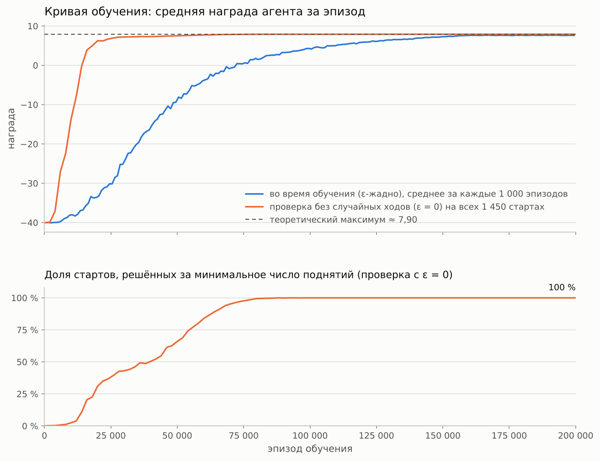

# ИСИТ — Практика 4: «Задача о компоте» (Q-learning)

Агент учится переливать компот по 5 стаканам так, чтобы везде стало поровну, и при этом поднимать стаканы минимальное число раз (одно поднятие = взял стакан и разлил из него в один или несколько других). Обучение с подкреплением, табличный Q-learning.

- `qlearning_compote.ipynb` — ноутбук: среда, агент, обучение, кривая обучения, проверка, примеры и подбор параметров
- `images/` — графики из ноутбука



## Модель
- **Состояние:** отклонения уровней 5 стаканов от среднего (от −3 до +3 порций) + какой стакан сейчас в руке.
- **Действие:** перелить 1 порцию из стакана *i* в стакан *j* (20 действий). Лить дальше из стакана, который уже в руке, — бесплатно; взять другой — новое поднятие.
- **Награда:** −1 за каждое поднятие, +10 когда во всех стаканах поровну. За решённый эпизод агент получает `10 − число поднятий`.
- **Обучение:** 200 000 эпизодов, α = 1, γ = 0,99, Q₀ = 10 (оптимистичная инициализация), ε: 1 → 0,05.

## Итог
Проверка на всех 1 450 возможных стартовых расстановках, агент действует без случайных ходов:

| | Обученный агент | Случайный агент | Теоретический предел |
|---|---|---|---|
| Средняя награда | 7,90 | −40,02 | 7,90 |
| Среднее число поднятий | 2,10 | 40,37 | 2,10 |
| Решено | 100 % | 3,5 % | — |
| Решено за минимум поднятий | **100 %** | 0,1 % | — |

Минимум поднятий — это число стаканов выше среднего: каждый такой стакан нужно поднять хотя бы раз, и одного раза хватает. Агенту это правило не сообщается, по нему только проверяется результат. Пример со слайда агент решает за 2 поднятия — это минимум.

## Запуск
```bash
pip install -r requirements.txt
jupyter notebook qlearning_compote.ipynb
```
Весь ноутбук выполняется примерно за 2 минуты. Можно открыть и в [Google Colab](https://colab.research.google.com/github/Mister-Gallardo/isit-qlearning-practice/blob/main/qlearning_compote.ipynb).
